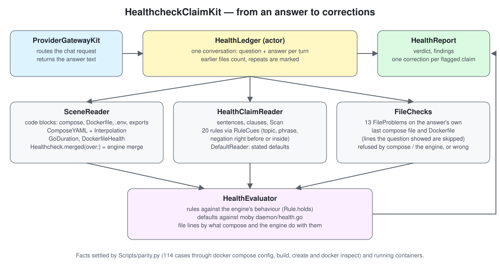
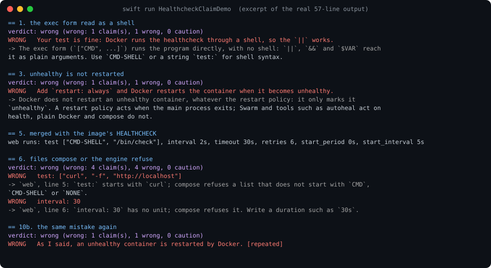
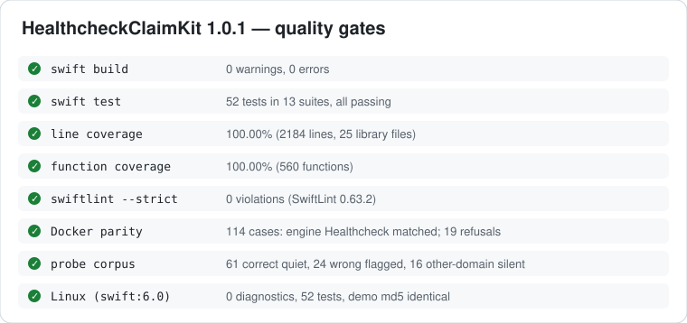

# HealthcheckClaimKit

**Checks what an LLM answer says about Docker healthchecks against what Docker Compose and the Docker engine actually do.**

Healthchecks are one of the places where a compose file "looks right" and quietly does something else, and where chat models are confidently wrong in both directions. `["CMD", "curl", "-f", "http://localhost", "||", "exit", "1"]` never runs a shell, so the `||` reaches `curl` as a URL. A string `test:` *does* run in `/bin/sh -c`, the opposite of a compose `command:` string. `$POSTGRES_USER` in a test is filled in by compose from your shell and `.env` when it reads the file, so a value set only in `environment:` becomes an empty string. Docker never restarts an unhealthy container, whatever the restart policy. `retries: 0` means "the default of 3". None of this is visible in the file.

HealthcheckClaimKit reads an answer (and the question, and earlier turns), finds what it states about healthchecks, and judges each statement. It sits after the model, next to the other claim checkers of this ecosystem, and it pairs with [ProviderGatewayKit](https://github.com/rajatslakhina/foundation-model-provider-gateway): the gateway produces the answer, this kit tells the user which healthcheck claims in it are wrong before they paste the file.



## What it checks

**General statements** (20 rules, each settled against the engine; see `Rule`):

| Statement | Truth (Docker Engine 27.4, Compose 2.32) |
|---|---|
| The exec form `["CMD", ...]` runs through a shell | Wrong: the engine execs the program; operators are arguments |
| A string `test:`, `CMD-SHELL`, Dockerfile shell form run through `/bin/sh -c` | Holds |
| An unhealthy container is restarted (with `restart: always`) | Wrong: it is only marked `unhealthy` (Swarm and autoheal sentences are not read) |
| The test runs on the host | Wrong: inside the container, like `docker exec` |
| Failures during `start_period` count toward `retries` | Wrong |
| Fields a compose `healthcheck:` leaves out keep the image's `HEALTHCHECK` values | Holds (and the opposite is wrong) |
| `disable: true` / `test: ["NONE"]` turns off the image's `HEALTHCHECK` | Holds |
| Only the last `HEALTHCHECK` in a Dockerfile takes effect; options do not carry over | Holds |
| A test that runs past `timeout` kills or restarts the container | Wrong: it counts as one failed check |
| `$NAME` in `test:` comes from the container's environment | Wrong: compose substitutes it from the shell and `.env`; `$$NAME` reaches the container |
| `retries: 0` fails on the first failure | Wrong: 0 means unset (the image's value, else 3) |

**Stated defaults**: "`interval` defaults to 5s" is wrong (30s; 5s is `start_interval`'s default). Defaults come from moby `daemon/health.go`: interval 30s, timeout 30s, retries 3, start_period 0s, start_interval 5s. Only settings written as code are read, so "ALB health checks run every 30 seconds by default" is not.

**The healthcheck lines of the answer's own compose file and Dockerfile** (13 problems, see `FileProblem`): a list that does not start with `CMD`/`CMD-SHELL`/`NONE` (compose refuses it), `test:` with no value, `interval: 30` (no unit), `1d` or `1m 30s` (Go cannot read them), anything below 1ms (the engine refuses the container), negative `retries`, an operator item in the exec form, `["CMD-SHELL", "curl", "-f", "url"]` (only `curl` is the script), `$$NAME` in the exec form or `$NAME` in a Dockerfile exec form (no shell expands it), a `$NAME` that only `environment:` sets, `localhost:<published port>` in the test, `retries: 0`, and `disable: true` next to a `test:`. A line the question already showed is not flagged, so an answer that quotes the broken file to explain it stays quiet.

## Install

```swift
.package(url: "https://github.com/rajatslakhina/healthcheck-claim-kit.git", from: "1.0.1")
```

and add `"HealthcheckClaimKit"` to your target. No dependencies. Swift 6, macOS 13 / iOS 16 and later, Linux.

## Usage

```swift
import HealthcheckClaimKit

let report = HealthClaimChecker().check(answer, context: question)
switch report.verdict {
case .wrong, .caution: show(report.corrections)   // one sentence per flagged claim
case .verified, .noClaims: break
}

// One conversation: files shown earlier still count, a mistake stated again is marked as repeated.
let ledger = HealthLedger()
let first = await ledger.review(firstAnswer, context: firstQuestion)
let second = await ledger.review(secondAnswer, context: secondQuestion)
print(second.repeatedCount)

// What a service's container actually gets: compose's healthcheck merged over the image's HEALTHCHECK.
let scene = HealthClaimChecker().scene(for: answerWithComposeAndDockerfile)
print(scene.effective("web")?.summary ?? "unknown image")
// test ["CMD-SHELL", "/bin/check"], interval 2s, timeout 30s, retries 6, start_period 0s, start_interval 5s
```

## Architecture

- **Reading the files.** A compose YAML subset (block and flow collections, quoted, literal and folded scalars; anchors and merges refused with a reason), compose's variable substitution (`$VAR`, `${VAR:-d}`, `$$`, shell over `.env`), Go's `time.ParseDuration`, and a Dockerfile `HEALTHCHECK` reader with `\` continuations, stage inheritance (`FROM base`), `NONE`, and the exec/shell split. `Healthcheck.merged(over:)` is the engine's merge: every field compose leaves unset or zero takes the image's value.
- **Reading the prose.** Sentences are split into clauses; a rule is read when its topic is in the clause, one of its phrases follows it, and the clause holds no negation other than one right before the phrase (or inside it: "doesn't restart", "can't turn off"). Instructions, questions, headings, suppositions ("you might expect", "a common misconception") and sentences about Kubernetes, Swarm, autoheal, systemd, load balancers and Podman state nothing. A clause about `command:` or `entrypoint:` is left to [ComposeCommandClaimKit](https://github.com/rajatslakhina/compose-command-claim-kit).
- **Judging.** `HealthEvaluator` compares each claim with the rule table, the defaults, or what compose and the engine do with the file line, and words a correction. `HealthLedger` (an actor) keeps the scene across turns.

## Demo

`swift run HealthcheckClaimDemo` checks ten answers (real output, 57 lines; excerpt):



## Quality gates (1.0.1)



- `swift build`: 0 warnings, 0 errors. `swiftlint lint --strict` (0.63.2): 0 violations.
- `swift test`: **52 tests in 13 suites** (Swift Testing), including 114 parity cases and 101 probe answers.
- Coverage (`swift test --enable-code-coverage --no-parallel`, `llvm-cov report`): **100.00% of lines (2184) and functions (560) on all 25 library files**; regions 99.51%.
- **Parity with Docker.** `Scripts/parity.py` runs 114 cases through `docker compose config`, `docker compose build --no-cache`, `docker compose create` and `docker inspect .Config.Healthcheck` under `env -i`, and writes `ParityFixture.swift`: test forms, 46 duration and retries spellings, variables from the shell, `.env` and `environment:`, the merge with an image `HEALTHCHECK`, and Dockerfile forms and stages. 19 cases are refused (11 by compose, 3 by the build, 5 by the engine). The kit gives the engine's exact `Healthcheck` for every case it reads; one case (a flow mapping holding a flow list) is declined by the YAML reader and asserted as unread.
- **Runtime facts** were observed on running containers (cached `postgres:18`, `sleep infinity`, 1s intervals): the exec form with `||` goes unhealthy, `CMD-SHELL` with the same text is healthy, `restart: always` never restarts an unhealthy container, failures in `start_period` leave the streak at 0, a timed-out test logs exit `-1` and the container keeps running, `["CMD-SHELL", "exit", "1"]` is healthy (only `exit` is the script).
- **Probes.** 61 correct answers stay quiet, 24 wrong ones are flagged by the intended rule or file check, 16 sentences from other domains (bash, regex, systemd, Kubernetes, ALB, nginx, the command kits' own sentences) give no claims. 20 of the correct ones came from a review that traced ordinary answers through the reader before tagging; all 20 were flagged by the first version.

## Changes

- **1.0.1**: `HealthScene.effective` / `HealthService.effective(image:)` return `nil` for a service whose image is unseen (an `image:` service, or a build whose base image is not shown), instead of compose's settings with the engine defaults filled in: an unseen `HEALTHCHECK` fills every field compose leaves unset. A check compose disables is still returned. Claims and file checks are unchanged.
- **1.0.0**: first release.

## Limits

- One compose file at a time; how several merge is [ComposeMergeClaimKit](https://github.com/rajatslakhina/compose-merge-claim-kit)'s.
- Stated per-service values ("`db` is checked every 10s") are not read yet; only stated defaults.
- `condition: service_healthy` without a healthcheck is left to [ComposeClaimKit](https://github.com/rajatslakhina/compose-claim-kit), so one mistake gets one note.
- An `image:` service's own `HEALTHCHECK` is unseen, so `effective` returns `nil` for it (its values would fill every field compose leaves unset), unless compose disables the check.
- A list of statements joined by commas is read as one clause; a negation elsewhere in a clause leaves it unread rather than guessed.

## License

MIT. See [LICENSE](LICENSE).
